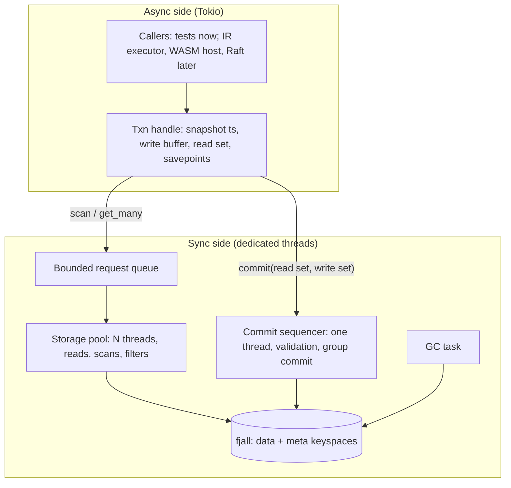

# ADR-0001: fjall Storage Engine and Async/Sync Boundary

## Status

Proposal

## Summary

The MVP storage layer is a single-node, embedded, transactional key-value layer built on fjall, used as a wrapped dependency rather than a fork. All fjall calls run on dedicated synchronous threads (a storage pool, a single commit sequencer and a GC task) behind a bounded request queue; async (Tokio) code never calls fjall directly, and no fjall iterator outlives a single storage-pool call.

## Context

Storage comes first because every later layer (relational IR, Cedar-based security, WASM runtime, Raft replication) depends on its guarantees, and those guarantees — key encoding, MVCC versioning, isolation semantics and the async/sync boundary — are the hardest to change once code is built on them.

fjall is a synchronous LSM-tree engine. Calling it from async tasks would block executor threads, and holding fjall iterators across `.await` points ties storage resources to arbitrary task lifetimes. Two options were considered:

- **Option 1: wrap fjall** and confine all calls to dedicated threads.
- **Option 2: fork fjall** and inject scheduler, file system and clock traits (useful for deterministic simulation).

Option 2 is more powerful but costly to maintain; option 1 is sufficient for the MVP provided the boundary is designed so option 2 can slot in later.

## Decision

Use fjall, wrapped (option 1). Async code handles waiting; sync code does storage work. The two meet at one batched trait ([ADR-0006](0006-batched-async-storage-trait.md)).

Components:

- **Txn handle (async side):** holds the snapshot timestamp, write buffer, read set and savepoint stack. Writes never touch storage until commit ([ADR-0004](0004-optimistic-transactions-and-isolation-levels.md)).
- **Storage pool:** reads and scans, including pushed-down filters. Default size is the number of cores (minimum 2), with a bounded queue (default 1,024 requests) that applies backpressure when full.
- **Commit sequencer:** one dedicated thread that validates, assigns commit timestamps and writes groups of transactions as single fjall batches ([ADR-0005](0005-commit-sequencer-group-commit-and-durability.md)).
- **GC task:** removes versions no snapshot can see, in chunks, on the storage pool at low priority ([ADR-0008](0008-version-garbage-collection.md)).

**Pool sizing:** reads, scans and GC share one storage pool. GC chunks are queued at low priority, with a cap on GC tasks in flight. A separate GC pool is added only if metrics show GC hurting read latency. (M5: the low-priority queue signals workers through the normal queue rather than a multi-queue select, so workers always wake on shutdown; see [ADR-0008](0008-version-garbage-collection.md).)

Rules:

- fjall is never called from an async task.
- No fjall iterator outlives one storage-pool call.

MVP scope: single node; no multi-process access to one database directory; no on-disk format stability across versions; no performance tuning beyond sane defaults.

## Implementation Phases

- [x] **Phase 1: Crate skeleton and keyspaces** - M1
- [x] **Phase 2: Storage pool, bounded queue and `Storage` trait** - M2

## Consequences

### Positive
- Async callers are never blocked by synchronous storage work.
- Storage resources (iterators) have bounded, call-scoped lifetimes.
- Everything that touches fjall sits behind the pool and sequencer, so a later fork with injected scheduler, file system and clock traits slots in underneath without API changes.
- The bounded queue gives natural backpressure.

### Negative
- Every read crosses a thread boundary, adding latency per call; the batched API ([ADR-0006](0006-batched-async-storage-trait.md)) is required to amortize it.
- Correctness depends on fjall's own fsync discipline for new files, which we don't control in a wrapped dependency.
- No deterministic simulation of the storage engine itself until option 2.

## Open Questions

- None.

## Future Work

- Option 2: fork fjall with injected scheduler, file system and clock traits.
- Raft replication per range, timestamp oracle, cross-range commits.
- Network endpoints and pgwire.
- Multi-process access and on-disk format stability.

## References

- `mvp-fjall-storage-design.md` — Summary, Goals and non-goals, Architecture overview
- [ADR-0002: Engine-Owned MVCC and Keyspace Layout](0002-engine-owned-mvcc-and-keyspace-layout.md)
- [ADR-0005: Commit Sequencer, Group Commit and Durability](0005-commit-sequencer-group-commit-and-durability.md)
- [ADR-0006: Batched Async Storage Trait](0006-batched-async-storage-trait.md)
- [ADR-0008: Version Garbage Collection](0008-version-garbage-collection.md)
- fjall: https://github.com/fjall-rs/fjall
