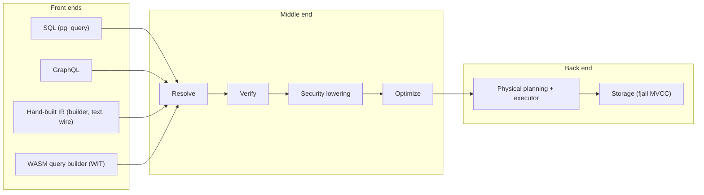

# ADR-0010: Typed Relational IR as the Single Middle End

## Status

Proposal

## Summary

Every query language (SQL, GraphQL, hand-built IR, WASM query builders) lowers into one typed relational algebra. The IR is resolved, verified, rewritten for security, optimized and handed to the executor as a physical plan. It has a fixed type system with explicit nullability, three-valued logic for SQL predicates, bag semantics by default, and a defined set of logical operators. DDL is not part of the IR.

## Context

The engine has several front ends and must enforce access control identically across all of them. A general-purpose middle end such as Apache Calcite treats security as a front-end concern and is storage-agnostic. We instead want:

- **Security as part of the IR's semantics**, so no entry point can skip it (see [ADR-0015](0015-security-core-and-policy-provider-contract.md)).
- **Co-design with one storage engine and its transactions**: plans carry transactional context, policy reads join the SSI read set ([ADR-0004](0004-optimistic-transactions-and-isolation-levels.md)), and leaf scans target the batched `ScanRequest` directly ([ADR-0006](0006-batched-async-storage-trait.md)).

A shared IR also means one implementation of typing and name-resolution rules rather than one per front end.

## Decision

### Position in the stack

Every entry point passes through all four middle-end stages in this order. No path from a front end reaches the optimizer or executor without verification and security lowering.

### Type system

The IR is fully typed after resolution. Front ends insert implicit casts during binding; the IR contains only explicit casts.

| Category | Types | Notes |
| --- | --- | --- |
| Scalars | bool, int2, int4, int8, float8, text, bytea, date, timestamptz, uuid | Postgres semantics: overflow and division by zero are errors |
| Document | jsonb | Produced when nested results are serialized for GraphQL; comparison and indexing deferred |
| Collections | array(T), record(fields) | Internal; Nest outputs these (as Arrow list-of-struct at run time), consumed by Unnest and serializers |
| Entity reference | entity(type) | Security sublanguage only; lowers to a table and primary key |

- **Nullability** is part of every type (`int8 not null` vs `int8`); the verifier and optimizer use it.
- **Three-valued logic** for SQL predicates: a filter keeps a row only when the predicate is TRUE.
- **Absence is not NULL.** The security sublanguage has no nulls (matching Cedar). NULL from a column becomes "absent" at the boundary; a missing attribute is an error contained per policy ([ADR-0016](0016-security-expression-sublanguage.md)).
- **Bag semantics** by default. `Distinct` and set operations without `ALL` make sets explicitly.

### Expressions

| Expression | Notes |
| --- | --- |
| Column reference | Resolved to (relation binding, column ID) |
| Literal, parameter | Parameters are typed; they make IR reusable as prepared statements |
| Function call | References a catalog function ID; properties come from the catalog ([ADR-0011](0011-function-property-catalog.md)) |
| Operators | Comparison, arithmetic, boolean with three-valued logic, LIKE, IS [NOT] NULL, IS [NOT] DISTINCT FROM |
| CASE, COALESCE, NULLIF | Short-circuit: branches not taken must not raise errors |
| Cast | Explicit only, with Postgres rules for which casts can fail |
| Aggregate call | Only inside Aggregate; DISTINCT and FILTER clauses supported |
| Subquery | Scalar, EXISTS, IN, ANY/ALL; lowered to Apply during resolution |

### Logical operators

All operators have a typed output schema.

| Operator | Purpose |
| --- | --- |
| `Get(table)` | All visible rows of a table at the transaction's snapshot |
| `Filter(input, predicate)` | Keep rows where the predicate is TRUE |
| `Project(input, exprs)` | Compute output columns |
| `Join(kind, left, right, cond)` | inner, left, right, full, semi, anti |
| `Apply(kind, outer, inner)` | Dependent join (LATERAL, correlated subqueries) |
| `Aggregate(input, keys, aggs)` | Grouping and aggregation |
| `Distinct(input)` | Remove duplicate rows |
| `Sort(input, keys)` | Direction and NULLS FIRST/LAST |
| `Limit(input, limit, offset)` | |
| `Union` / `Intersect` / `Except` | With and without ALL |
| `Values(rows)` | Literal relation |
| `Nest(input, keys, shape)` | Collect each group's rows into a typed array of records ([ADR-0012](0012-nesting-and-decorrelation-for-graphql.md)) |
| `Unnest(input, expr)` | Expand an array into rows |
| `Insert(table, input, returning)` | |
| `Update(table, input, assignments, returning)` | Input carries the target rows' keys |
| `Delete(table, input, returning)` | |
| `PolicyFilter(input, residual)` | **Privileged.** Security barrier ([ADR-0018](0018-policy-barrier-and-write-check-plan-constructs.md)) |
| `WriteCheck(input, check)` | **Privileged.** Per-row authorization on DML ([ADR-0018](0018-policy-barrier-and-write-check-plan-constructs.md)) |

DDL is not part of the IR. Catalog changes go through the catalog API inside a transaction ([ADR-0007](0007-minimal-catalog-and-row-layer.md)).

### Representation (I1)

The IR lives in the `interlaken-ir` crate, which does not depend on storage.

- **One tree for both forms.** Unresolved and resolved IR ([ADR-0013](0013-ir-forms-formats-resolver-and-verifier.md)) share one `Rel`/`Expr` tree. Each reference is an enum with a variant per form: tables and functions by name or catalog ID, columns by name or by binding, DML target columns by name or column ID. The resolver rewrites references and nothing else; the verifier (I2) checks that resolved IR has no names left.
- **Bindings.** Every operator that introduces columns (`Get`, `Project`, `Aggregate`, `Values`, set operations, `Nest`, `Unnest`, DML) carries a `BindingId`, unique within a plan. A resolved column reference is `(binding, column)`: the catalog column ID for a table, the output position otherwise. Pass-through operators (`Filter`, `Join`, `Apply`, `Sort`, `Limit`, `Distinct`, `PolicyFilter`, `WriteCheck`) have no binding. DML operators have two: one for the target row, which `RETURNING` reads (new values for insert and update, old values for delete), and one for the `RETURNING` output.
- **Aggregates are not expressions.** Aggregate calls appear only in `Aggregate`'s list, so "aggregates only inside Aggregate" holds by construction. The verifier still checks that a scalar call never resolves to an aggregate function.
- **Operators are nodes, not function calls.** Comparison, arithmetic, `LIKE`, `IS [NOT] NULL` and `IS [NOT] DISTINCT FROM` are dedicated expression nodes; `AND` and `OR` are n-ary. The function catalog (I2) supplies their properties by operator and operand types.
- **Apply kinds:** inner, left, semi, anti and single. Single is a left apply that fails on more than one inner row; scalar subqueries lower to it.
- **`Nest`** takes grouping keys, record fields and a column name. Its output is the keys followed by one `array(record(fields))` column.
- **Literals.** `NULL` is untyped; resolved IR wraps a NULL that needs a type in an explicit cast. `date` is days since 1970-01-01 and `timestamptz` is microseconds since the Unix epoch, matching Arrow's `Date32` and `Timestamp(µs, UTC)`. IR equality compares floats by bit pattern but treats every NaN as one value, as Postgres does.
- **IDs:** table, function, column and binding IDs are `u32`; schema versions are `u64`. The storage-backed catalog converts storage IDs.

### MVP scope

| In the MVP | Deferred |
| --- | --- |
| Types above | numeric, intervals, ranges, user-defined types, ICU collations |
| Operators above | Window functions, recursive CTEs, upsert, MERGE |
| Rust builder, text format, shared resolver | SQL front end, GraphQL front end, Substrait wire format |

The SQL and GraphQL front ends are separate projects that start once the IR is stable. The MVP proves the IR through the builder and text format.

## Implementation Phases

- [x] **Phase 1: Types, expressions, operators, builder, text format** - I1

## Consequences

### Positive
- One place to enforce security and one implementation of typing rules for all front ends.
- Explicit nullability and casts simplify the verifier and optimizer.
- Prepared statements fall out of typed parameters.

### Negative
- The IR is tied to this storage engine and its transactions; it is not a reusable general middle end.
- Front ends wait on IR stability before they can start.

## Open Questions

- None specific beyond those in related ADRs.

## Future Work

- numeric, intervals, ranges, user-defined types, ICU collations.
- Window functions, recursive CTEs, upsert, MERGE.
- jsonb comparison and indexing.
- SQL (pg_query) and GraphQL front ends.

## References

- `ir-design.md` — Summary, Position in the stack, Type system, Expressions, Relational operators
- [ADR-0006](0006-batched-async-storage-trait.md), [ADR-0007](0007-minimal-catalog-and-row-layer.md), [ADR-0011](0011-function-property-catalog.md), [ADR-0013](0013-ir-forms-formats-resolver-and-verifier.md), [ADR-0015](0015-security-core-and-policy-provider-contract.md), [ADR-0022](0022-vectorized-arrow-stream-executor.md)
- Apache Calcite (contrast)
