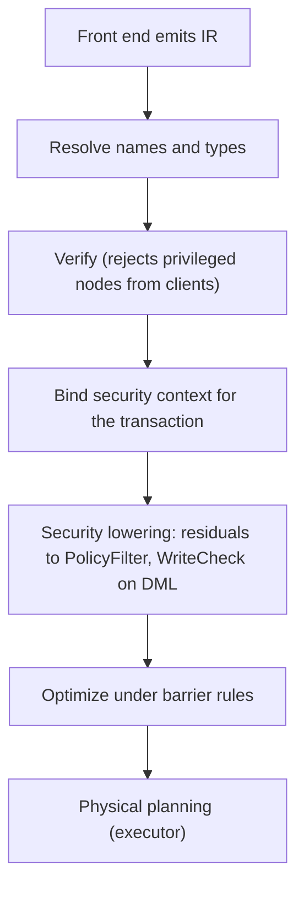

# ADR-0013: IR Forms, Formats, Resolver and Verifier

## Status

Proposal

## Summary

The IR exists in an unresolved form (names) and a resolved form (catalog IDs plus schema version, fully typed). One shared resolver turns the first into the second for every front end. The IR has a Rust builder, an S-expression text format and, later, a Substrait-based wire format. A verifier runs on every IR from every source and rejects privileged nodes that the engine's own passes didn't produce. The compilation pipeline order is fixed. Every stage reads catalog metadata through a `Catalog` trait with an in-memory implementation, so IR work does not wait for the storage-backed catalog.

## Context

IR arrives from people, tools, generated code, cached plans and untrusted clients (including WASM). Each source must be checked identically, and clients must not be able to inject security nodes or claims. Name lookup and type checking must have one implementation shared by SQL and GraphQL binders.

The storage-backed catalog (`sys_*` tables, [ADR-0007](0007-minimal-catalog-and-row-layer.md)) arrives at storage milestone M4, but the resolver and verifier are needed from IR milestone I2, which starts after M2.

## Decision

### Two forms

| Form | References | Produced by | Notes |
| --- | --- | --- | --- |
| Unresolved | Tables, columns and functions by name; types optional | People, simple tools, the text format | Passes through the shared resolver |
| Resolved | Catalog object IDs plus the catalog schema version; fully typed | The resolver, generated code, cached plans | Still verified against the current catalog before running |

The SQL and GraphQL binders use the same resolver.

### Three formats

- **Rust builder** in the style of a dataframe API, for embedding, tests and new front ends.
- **Text format** (S-expressions): golden tests, debugging, and `EXPLAIN` output that can be pasted back in and run.
- **Wire format** (later): Substrait plus our own extensions, versioned, translated into the internal IR. The internal IR stays free to change.

**Text format (I1).** The full grammar is in the `interlaken_ir::text` module docs. In outline:
- Every operator and expression is a list headed by its name, such as `(filter REL EXPR)` or `(+ a b)`. `:name value` keyword arguments carry optional parts (`:as`, `:bind`, `:schema-version`) and may appear anywhere in a list.
- Atoms:
  - integers are `int8` literals and floats are `float8`;
  - `#b.c` is a bound column;
  - dotted symbols are names, with `|...|` quoting any segment that is not a plain identifier;
  - `true`, `false` and `null` are literals, so they must be quoted to be used as names.
- Other literal types use typed forms, such as `(date "2026-11-19")` and `(int4 5)`.
- Printing is canonical. A list that fits in 80 columns stays on one line; otherwise its head, leading atoms and keywords stay on the first line and each remaining argument is indented on its own line.
- Parsing printed text always gives equal IR. Errors carry line and column, and nesting deeper than 200 levels is rejected rather than overflowing the stack.

### Catalog trait

The resolver, verifier, security lowering, optimizer and reference interpreter ([ADR-0021](0021-ir-correctness-and-security-testing.md)) read catalog metadata only through a `Catalog` trait:

```rust
pub trait Catalog: Send + Sync {
    /// Current catalog schema version (resolved IR is pinned to one).
    fn schema_version(&self) -> SchemaVersion;

    fn table_by_name(&self, name: &QualifiedName) -> Option<TableDef>;
    fn table_by_id(&self, id: TableId) -> Option<TableDef>;   // columns, types, keys, indexes
    fn function_by_name(&self, name: &QualifiedName, args: &[Type]) -> Option<FunctionDef>;
    fn function_by_id(&self, id: FunctionId) -> Option<FunctionDef>; // properties, ADR-0011

    /// Entity declarations and membership tables, ADR-0017.
    fn entity_by_type(&self, ty: &EntityType) -> Option<EntityDef>;
    fn entity_for_table(&self, id: TableId) -> Option<EntityDef>;
}
```

- **In-memory implementation:** built from Rust or the text format, used by IR milestones I1–I3, golden tests and the reference interpreter. IR work proceeds before storage M4.
- **Storage-backed implementation:** reads `sys_tables`, `sys_columns`, `sys_indexes` and `sys_entities` from the transaction's snapshot ([ADR-0007](0007-minimal-catalog-and-row-layer.md), [ADR-0017](0017-entities-and-hierarchy-closure-table.md)). Arrives with storage M4.
- Signatures above are indicative; the exact shape is settled in I2.
- **As implemented (I1):**
  - Lookups return shared `Arc` definitions.
  - `functions_by_name` returns every overload, because the resolver needs all the candidates to apply implicit casts. `function_by_name` is a provided method that matches argument types exactly.
  - `TableDef` carries columns (with nullable types) and the primary key; indexes join when the optimizer needs them.
  - `InMemoryCatalog` is built from Rust and rejects duplicate IDs and names, and nullable primary key columns.
  - Entity lookups arrive with the security core in I4.
  - A text form for catalogs arrives in I2, with the resolver's golden tests.

### Verifier

Runs on every IR from every source, after resolution:

- Structure is well formed; every reference exists in the catalog at the stated schema version.
- Types check; aggregates appear only inside Aggregate; correlated references are bound by an enclosing Apply.
- **No privileged nodes from clients.** `PolicyFilter`, `WriteCheck`, security context overrides and system-catalog writes are rejected unless the engine's own passes produced them. Clients cannot claim a function is leakproof ([ADR-0011](0011-function-property-catalog.md)).

### Compilation pipeline



- Prepared statements cache the resolved, verified IR per schema version.
- Security lowering is redone per execution, because the residual depends on the principal and context; residuals are cached separately ([ADR-0019](0019-transactional-authorization-and-residual-cache.md)).

## Implementation Phases

- [x] **Phase 1: Builder, text format, `Catalog` trait and in-memory implementation** - I1
- [ ] **Phase 2: Resolver and verifier against the in-memory catalog** - I2
- [ ] **Phase 3: Storage-backed `Catalog` over `sys_*` tables** - after storage M4

## Consequences

### Positive
- One resolver for all front ends; one verifier for all sources.
- Privileged-node rejection makes hand-built and WASM IR safe to accept.
- Text format doubles as test fixtures and executable `EXPLAIN` output.
- The internal IR can evolve independently of the external wire format.
- The `Catalog` trait decouples IR milestones I1–I3 from storage M4 and makes IR tests run without storage.

### Negative
- Resolved IR must be re-verified against the current catalog, adding work per execution.
- Security lowering cannot be cached as part of the prepared statement.
- Two catalog implementations must stay behaviourally identical; shared conformance tests are needed.

## Open Questions

- None recorded in the source.

## Future Work

- Substrait-based wire format with versioned extensions.

## References

- `ir-design.md` — Names, resolution and formats; Compilation pipeline
- [ADR-0007](0007-minimal-catalog-and-row-layer.md), [ADR-0010](0010-typed-relational-ir.md), [ADR-0011](0011-function-property-catalog.md), [ADR-0015](0015-security-core-and-policy-provider-contract.md), [ADR-0017](0017-entities-and-hierarchy-closure-table.md), [ADR-0019](0019-transactional-authorization-and-residual-cache.md), [ADR-0021](0021-ir-correctness-and-security-testing.md), [ADR-0028](0028-physical-operators-planning-and-explain.md)
- Substrait
