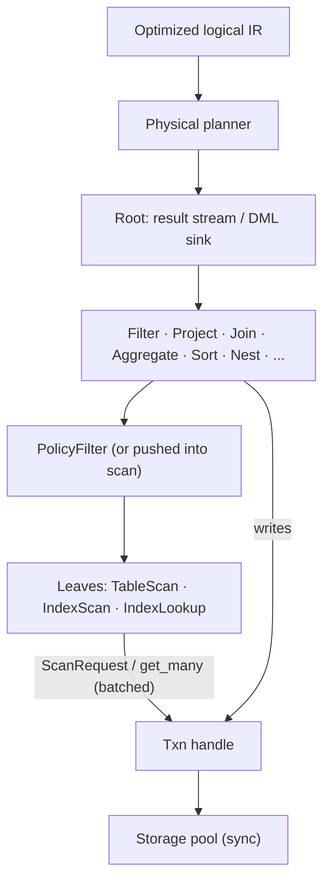

# ADR-0022: Vectorized Arrow Stream Executor

## Status

Proposal

## Summary

The executor runs physical plans produced from the optimized IR as a vectorized, pull-based tree of async streams of `arrow-rs` `RecordBatch`es, one Tokio task per query. Leaf operators are the only code that awaits I/O (the storage layer); everything above them is CPU work on columnar batches that yields cooperatively. Dropping the stream cancels the query.

## Context

The IR ([ADR-0010](0010-typed-relational-ir.md)) needs an execution engine that fits three constraints from the rest of the system:

- Storage is synchronous and batched behind an async trait ([ADR-0001](0001-fjall-storage-engine-and-async-sync-boundary.md), [ADR-0006](0006-batched-async-storage-trait.md)); per-row calls across that boundary would dominate cost.
- Security barriers must be enforced at run time, not only in plan shape ([ADR-0025](0025-runtime-security-enforcement-in-executor.md)).
- Queries run inside transactions and must see their own writes ([ADR-0026](0026-statement-atomicity-and-halloween-protection.md)).

A row-at-a-time (Volcano) executor is simple but slow and makes batched storage calls awkward. Push-based pipelines and intra-query parallelism are higher-throughput but more complex, and partitioned parallelism needs ranges to partition on, which don't exist until replication. A shared columnar format also matters for WASM UDFs ([ADR-0029](0029-wasm-udf-interface.md)) and for cross-checking plans against DataFusion or DuckDB.

## Decision

**Batch format.** Batches are `arrow-rs` `RecordBatch`es, targeting 1,024 rows (matching the storage layer's default `limit_rows`). `arrow-rs` compute kernels are reused for comparison, arithmetic, casting, sorting and hashing where their semantics match Postgres ([ADR-0024](0024-expression-evaluation-with-postgres-semantics.md)).

**Execution model.**

- **Pull-based streams.** Every physical operator implements `Stream<Item = Result<RecordBatch>>`. The root pulls; each operator pulls from its children as needed.
- **One task per query.** Joins and aggregations run within that task.
- **Cooperative scheduling.** CPU-heavy operators (hash builds, sorts, large aggregations) yield to the Tokio scheduler every N batches or after ~1 ms of CPU, whichever comes first (both configurable), so one query can't starve other connections or Raft heartbeats.
- **Storage calls are the only I/O awaits.** A leaf awaits the storage pool; meanwhile the executor thread serves other queries.
- **Shared transaction.** All leaves and DML sinks of a query hold clones of the same cloneable `Txn` handle ([ADR-0006](0006-batched-async-storage-trait.md)), so concurrent reads and writes within one plan need no extra locking in the executor.
- **Cancellation.** Dropping the stream cancels the query. A storage call already running on the pool completes and its result is discarded; the pool is never interrupted mid-call.
- **Timeouts.** `statement_timeout` cancels the stream from outside.

**Testing.** Correctness is established differentially against the naive row-at-a-time reference interpreter of the IR ([ADR-0021](0021-ir-correctness-and-security-testing.md)): every operator is tested on random data and random plans. Cancellation tests check that queries cancelled mid-scan release resources. Kernel, short-circuit, Halloween, security and memory tests are covered in [ADR-0024](0024-expression-evaluation-with-postgres-semantics.md), [ADR-0026](0026-statement-atomicity-and-halloween-protection.md), [ADR-0025](0025-runtime-security-enforcement-in-executor.md) and [ADR-0027](0027-query-memory-management.md). sqllogictest suites and differential runs against Postgres follow once the SQL front end exists.

## Implementation Phases

- [ ] **Phase 1: Stream framework, Arrow batches, TableScan, Filter, Project, Limit, reference interpreter** - E1
- [ ] **Phase 2: Remaining operators on the framework** - E3 (see [ADR-0028](0028-physical-operators-planning-and-explain.md))

## Consequences

### Positive
- Vectorized kernels amortise per-row overhead; batch granularity matches storage calls.
- Reuses tested `arrow-rs` kernels and gives one layout for WASM UDFs and cross-engine comparison.
- Async streams make cancellation and timeouts simple (drop the stream).
- Cooperative yielding protects latency of other connections and Raft heartbeats.

### Negative
- Single-task queries: analytical queries over large tables will be slower than parallel engines (not an MVP goal).
- Some `arrow-rs` kernels differ from Postgres semantics and need per-kernel verification.
- Cancelled storage calls still run to completion on the pool.

## Open Questions

- None.

## Future Work

- Intra-query (partitioned) parallelism once ranges exist.
- Push-based pipelines.
- JIT or WASM code generation for expressions.
- sqllogictest and differential testing against Postgres.

## References

- `executor-design.md` — Summary, Data format, Execution model, Testing strategy
- [ADR-0001](0001-fjall-storage-engine-and-async-sync-boundary.md), [ADR-0006](0006-batched-async-storage-trait.md), [ADR-0010](0010-typed-relational-ir.md), [ADR-0021](0021-ir-correctness-and-security-testing.md)
- [ADR-0023](0023-leaf-operators-and-storage-pushdown.md) through [ADR-0029](0029-wasm-udf-interface.md)
- Apache Arrow / `arrow-rs`
