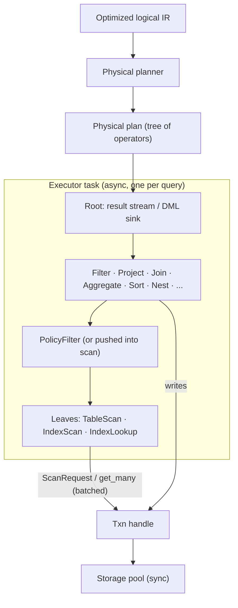

# MVP Design Proposal: Query Executor

*Draft — 2026-11-16 · Companion to `mvp-fjall-storage-design.md` and `ir-design.md`*

## Summary

The executor runs physical plans produced from the optimized IR. It is a vectorized, pull-based executor written as async streams of Apache Arrow record batches. Leaf operators are the only code that calls the storage layer, through the batched `Storage` trait; everything above them is CPU work on columnar batches.

It is designed around three constraints from the rest of the system:

- **Storage is synchronous and batched.** Leaves issue one storage call per batch, never per row, and push filters, projections and limits into `ScanRequest`.
- **Security barriers are execution rules, not just plan shapes.** Policy filters run before any non-leakproof expression sees a row, and errors from rows a caller can't see never surface.
- **Queries run inside transactions.** Reads see the transaction's own writes, DML buffers into the transaction, and statements are atomic.

The MVP succeeds when:

- Every operator in the physical plan set passes differential tests against a naive row-at-a-time reference interpreter of the IR.
- Postgres error semantics hold: division by zero, overflow and invalid casts raise errors, and short-circuit expressions never raise errors from branches not taken.
- An `UPDATE` that changes the key it scans on terminates and touches each row once (no Halloween problem).
- A query over 10 million rows runs in bounded memory for streaming operators and fails cleanly when a blocking operator exceeds its memory budget.

## Goals and non-goals

| Area | In the MVP | Deferred |
| --- | --- | --- |
| Model | Pull-based async streams of Arrow batches, one task per query | Intra-query parallelism, push-based pipelines |
| Operators | Scans, index lookups, filter, project, hash and nested-loop joins, hash and stream aggregation, sort, top-N, limit, set operations, Nest, Unnest, DML sinks, PolicyFilter, WriteCheck | Merge join, window functions, spilling to disk |
| Expressions | Vectorized interpretation with selection vectors | JIT or WASM code generation |
| Memory | Per-query budget, clean failure when exceeded | Spilling sorts and hash tables |
| Functions | Built-in scalar and aggregate functions | WASM UDF calls (interface designed now, implemented with the WASM runtime) |
| Observability | `EXPLAIN`, `EXPLAIN ANALYZE` with per-operator metrics | Query profiling UI, plan history |

## Architecture overview

## Data format: Apache Arrow

**Decision: batches are `arrow-rs` `RecordBatch`es.**

- Columnar batches suit vectorized kernels, and `arrow-rs` provides tested compute kernels for comparison, arithmetic, casting, sorting and hashing.
- The same layout is how batches will be passed to WASM UDFs (copied into guest memory once per batch) and how plans can be cross-checked against DataFusion or DuckDB later.
- **Batch size:** target 1,024 rows, matching the storage layer's default scan limit.

### Where rows become columns

The storage layer returns encoded rows. Decoding into Arrow happens in two phases:

1. **MVP:** the scan operator decodes rows into Arrow on the async side, then applies any filter that wasn't pushed into storage.
2. **Later:** a `BatchDecoder` extension to `ScanRequest` decodes, filters and projects on the storage thread and returns Arrow directly, so rows that fail the filter are never copied across the boundary. This is a planned change to the storage trait.

## Physical operators

| Operator | Notes |
| --- | --- |
| `TableScan` | Primary key range; pushed-down filter, projection and limit go into `ScanRequest`; follows resume keys |
| `IndexScan` | Secondary index range, yielding primary keys and index columns |
| `IndexLookup` | Fetches rows by primary key with `get_many`, one call per input batch |
| `Filter` | Vectorized predicate, producing a selection vector |
| `Project` | Vectorized expressions |
| `HashJoin` | inner, left, right, full, semi, anti; build side chosen by the planner |
| `NestedLoopJoin` | For `Apply` that couldn't be decorrelated and for non-equi joins; inner side re-evaluated or cached per outer batch |
| `HashAggregate` / `StreamAggregate` | Stream aggregation when input is already sorted on the group keys |
| `Sort` / `TopN` | In-memory; TopN for `ORDER BY ... LIMIT` |
| `Limit` | Stops pulling from its input once satisfied |
| `Union` / `Intersect` / `Except` | Hash-based for the distinct forms |
| `Values` | Literal rows |
| `Nest` | Builds jsonb (or Arrow list/struct) values per group, for GraphQL output |
| `Unnest` | Expands arrays into rows |
| `Insert` / `Update` / `Delete` | Sinks that buffer writes into the transaction and maintain indexes through the row layer |
| `PolicyFilter` | Security barrier (below) |
| `WriteCheck` | Per-row authorization before writes enter the transaction |

## Execution model

- **Pull-based streams.** Each operator implements `Stream<Item = Result<RecordBatch>>`. The root pulls; each operator pulls from its children as it needs batches.
- **One task per query** in the MVP. Joins and aggregations run within it. Partitioned intra-query parallelism comes later, once ranges exist to partition on.
- **Cooperative scheduling.** CPU-heavy operators (hash builds, sorts, large aggregations) yield to the Tokio scheduler every few batches, so one large query can't starve other connections or Raft heartbeats.
- **Storage calls are the only awaits on I/O.** A leaf awaits the storage pool; while it waits, the executor thread serves other queries.
- **Cancellation.** Dropping the stream cancels the query. A storage call already running on the pool completes and its result is discarded; the pool itself is never interrupted mid-call.
- **Timeouts.** `statement_timeout` cancels the stream from outside.

## Expression evaluation

Expressions are interpreted over Arrow arrays, using `arrow-rs` kernels where their semantics match Postgres and our own kernels where they don't.

- **Three-valued logic.** Filters keep rows only where the predicate is TRUE; NULL and FALSE both drop the row.
- **Postgres error semantics.** Integer overflow, division by zero and failed casts raise errors with the matching SQLSTATE, rather than wrapping or producing NULL.
- **Selection vectors for short-circuit evaluation.** `CASE`, `AND`, `OR` and `COALESCE` evaluate each branch only on the rows that reach it. A naive vectorized kernel evaluates every branch on every row and raises errors Postgres wouldn't (for example, `CASE WHEN x <> 0 THEN 10 / x END`).
- **Error containment for the security sublanguage.** `Try(expr, default)` evaluates with an error mask: rows whose evaluation fails get `default` instead of failing the batch.

## Security in the executor

The IR proposal defines the barrier rules; the executor enforces them at run time.

- **Ordering.** A `PolicyFilter` runs before any operator that evaluates a non-leakproof expression on the same rows. The physical planner only pushes leakproof expressions below it.
- **Pushdown of the residual.** The policy residual is built only from leakproof operators, so it is usually pushed into `ScanRequest` and runs on the storage thread. Rows the caller can't see never leave the storage pool.
- **No leaked errors.** Errors from evaluating the residual are contained per row. Non-leakproof user expressions only ever run on rows that passed the policy, so their errors can't reveal hidden rows.
- **Write checks.** `WriteCheck` runs on each batch of new or changed rows before they are buffered into the transaction. A failure aborts the statement with a permission error naming the table, never a row's values.
- **WASM host calls** build their scans through the same planner path, so they get the same `PolicyFilter` and pushdown.

## Transactions and statements

- **Reads.** Every leaf reads through the transaction's `Txn` handle, so results include the transaction's own uncommitted writes.
- **Statement boundaries.** Before each statement, the executor calls `next_statement()` (refreshing the snapshot under READ COMMITTED) and takes an implicit savepoint.
- **Statement atomicity.** A statement that fails rolls back to its savepoint. As in Postgres, the transaction then enters an aborted state until the client rolls back, either fully or to an explicit savepoint.
- **Halloween protection.** DML reads the write buffer *as of the start of the statement*. Writes are tagged with a statement sequence number, and scans within a statement ignore writes from that same statement. An `UPDATE` that moves rows forward in the key order it's scanning therefore can't see and update them again.
- **Retries.** A `SerializationFailure` at commit is returned to the caller with SQLSTATE `40001`. The executor doesn't retry on its own; retry policy belongs to the client or the WASM host.

## Memory management

- **Per-query budget** (default 256 MiB), tracked through Arrow buffer sizes for blocking operators: hash tables, sort buffers, aggregation state and `Nest` accumulators.
- **Streaming operators** (scan, filter, project, limit, probe side of a hash join) hold only a few batches and don't count against the budget in practice.
- **Exceeding the budget** fails the query with a clear error naming the operator. Spilling to disk is deferred.
- **Node-level cap.** A global limit across concurrent queries prevents many medium queries from exhausting the container.

## Nest and GraphQL output

- `Nest` collects each group's child rows into jsonb arrays (or Arrow list-of-struct columns), so a decorrelated GraphQL query produces one result row per root object, with children inline.
- The GraphQL front end serializes those values directly into the response. No second round of queries is needed.
- Ordering and limits inside nested fields (`children(first: 10, orderBy: ...)`) are applied inside the group before nesting.

## WASM UDF interface (designed now, built later)

- **Batch calls.** A `UdfProject` operator calls a WASM function once per batch, with columns copied into the guest's linear memory in Arrow layout. Per-row calls across the boundary would dominate cost.
- **Async calls.** wasmtime's async support suspends the guest while it awaits host calls, so no executor thread blocks.
- **Limits.** Fuel or epoch interruption for CPU, memory caps per instance, and cancellation tied to the query's stream.
- **Determinism and properties.** Only functions declared deterministic may run in read-write transactions; volatility and leakproofness come from the catalog.
- **Pooling.** Instances come from wasmtime's pooling allocator, one per query or batch, never shared across transactions.

## Physical planning (MVP)

- Choose scan versus index scan from the predicates on indexed columns: equality on a unique index becomes `IndexLookup`; a range on an index prefix becomes `IndexScan`.
- Push filters, projections and limits into `ScanRequest`, subject to the barrier rules.
- Choose `HashJoin` for equi-joins with the smaller estimated side as the build side (estimates from simple heuristics until statistics exist), `NestedLoopJoin` otherwise.
- Use `StreamAggregate` and merge-friendly plans when input order allows; otherwise hash.

## Observability

- **`EXPLAIN`** prints the physical plan, including what was pushed into each `ScanRequest` and where each `PolicyFilter` sits.
- **`EXPLAIN ANALYZE`** adds per-operator metrics: rows and batches produced, elapsed time, storage calls and bytes read, and peak memory.
- Policy residuals appear in `EXPLAIN` output only to principals allowed to see policy definitions.

## Testing strategy

| Technique | Checks |
| --- | --- |
| Reference interpreter | A deliberately naive row-at-a-time evaluator of the IR; every operator is differentially tested against it on random data and random plans |
| Kernel property tests | NULL propagation, three-valued logic, overflow and division errors, cast rules |
| Short-circuit tests | Expressions whose untaken branches would error must not raise |
| Halloween tests | Updates that move rows within the scanned key range touch each row once |
| Security tests | The IR security oracle and leak suite, run end to end through the executor |
| Cancellation and memory | Queries cancelled mid-scan release resources; budget overruns fail cleanly |
| Later | sqllogictest suites and differential runs against Postgres once the SQL front end exists |

## Milestones

Roughly 11 weeks for one experienced engineer. It can start after storage milestone M2 and run alongside IR milestones I1–I3.

| # | Milestone | Duration | Exit criteria |
| --- | --- | --- | --- |
| E1 | Stream framework, Arrow batches, TableScan, Filter, Project, Limit, reference interpreter | 2 weeks | Differential tests pass for scan, filter, project |
| E2 | Expression kernels with Postgres semantics and selection vectors | 2 weeks | Kernel and short-circuit tests pass |
| E3 | Joins, aggregation, sort, top-N, set operations, Values | 3 weeks | Differential tests pass for all operators |
| E4 | DML sinks, statement atomicity, Halloween protection, index scans and lookups | 2 weeks | Halloween and statement tests pass |
| E5 | PolicyFilter, WriteCheck, Nest, Unnest, memory budget, EXPLAIN ANALYZE | 2 weeks | Security oracle passes end to end; nested results correct |

## Risks and open questions

### Risks

- **Arrow kernel semantics.** Some `arrow-rs` kernels differ from Postgres on overflow, NULL handling and casts. Each kernel we reuse needs semantic tests; mismatches get our own implementation.
- **Decode cost on the async side.** Phase 1 decodes on executor threads. If it shows up in profiles, the `BatchDecoder` change moves it into the storage pool sooner.
- **No spilling.** Large sorts and joins fail at the memory budget. Acceptable for the target workload size; revisit with real usage.
- **Single-task queries.** Analytical queries over large tables will be slower than parallel engines. Not a goal for the MVP.

### Open questions

- Should `Nest` produce jsonb directly or Arrow list/struct columns that the GraphQL serializer converts? jsonb is simpler; Arrow keeps types and is cheaper to serialize.
- Default memory budget per query and per node for the container sizes we expect.
- Should a hash join's build side be chosen at run time (after seeing input sizes) rather than at planning time?
