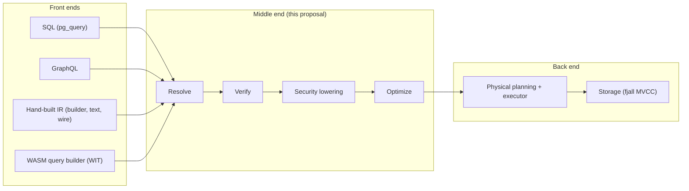
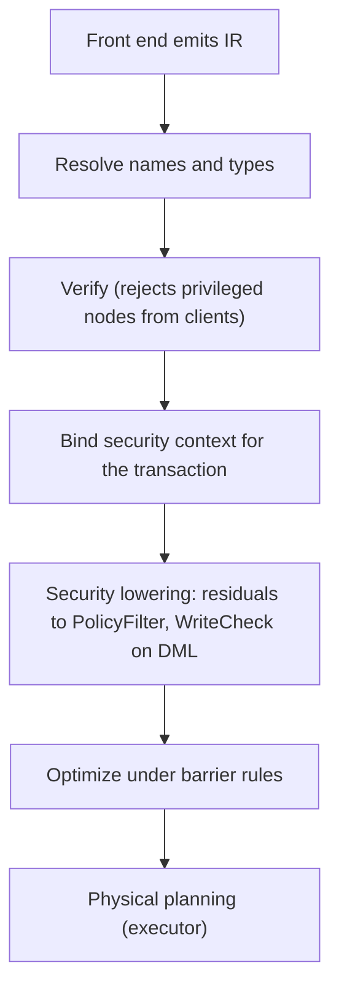

# MVP Design Proposal: Relational IR and Security Core

*Draft — 2026-11-16 · Companion to `mvp-fjall-storage-design.md` and `executor-design.md`*

## Summary

The IR is the engine's middle end: a typed relational algebra that every query language lowers into, and the single place where access control is enforced. Front ends (SQL first, GraphQL second, hand-built IR and WASM query builders alongside) produce IR. The IR is resolved, verified, rewritten for security, optimized, and handed to the executor as a physical plan.

Two design choices set it apart from a general-purpose middle end such as Apache Calcite:

- **Security is part of the IR's semantics, not a front-end feature.** Policies from a pluggable provider (Cedar first) are partially evaluated into predicates that the IR injects, places behind a security barrier, and constrains the optimizer around. No entry point can skip this step.
- **The IR is co-designed with one storage engine and its transactions.** Plans carry transactional context, policy reads join the SSI read set, and leaf scans target the storage layer's batched `ScanRequest` directly.

The MVP succeeds when:

- A hand-built IR query and the same query expressed through the Rust builder produce identical plans and results.
- For every query in a randomized suite, the result with policies applied equals the unrestricted result filtered row by row through the provider's `authorize` call.
- No test in the leak suite (errors, UDF side effects, timing-independent probes) reveals a row the caller isn't permitted to see.
- Correlated subqueries and GraphQL-shaped nested queries are decorrelated into joins where possible and return correct nested results.

## Goals and non-goals

| Area | In the MVP | Deferred |
| --- | --- | --- |
| Types | bool, int2/4/8, float8, text, bytea, date, timestamptz, uuid, jsonb (output), arrays and records (internal) | numeric, intervals, ranges, user-defined types, ICU collations |
| Operators | Get, Filter, Project, Join (all kinds), Apply, Aggregate, Distinct, Sort, Limit, set operations, Values, Nest, Unnest, Insert, Update, Delete | Window functions, recursive CTEs, upsert, MERGE |
| Entry points | Rust builder, text format, shared resolver | SQL front end, GraphQL front end, Substrait wire format |
| Optimizer | Rule-based rewrites, decorrelation, predicate and projection pushdown | Cost-based join ordering, statistics, Cascades memo |
| Security | Provider contract, security expression sublanguage, PolicyFilter, WriteCheck, leakproof rules, residual cache, Cedar provider, deploy-time analysis | Column masking functions, additional providers |
| Functions | Built-in scalar and aggregate functions with declared properties | WASM UDFs (hook only, properties modelled now) |

The SQL and GraphQL front ends are separate projects that start once this IR is stable. The MVP proves the IR through the builder and text format first.

## Position in the stack



Every entry point passes through all four middle-end stages in this order. There is no path from a front end to the optimizer or executor that bypasses verification or security lowering.

## Type system

The IR is fully typed after resolution. Front ends insert implicit casts during binding; the IR itself contains only explicit casts.

| Category | Types | Notes |
| --- | --- | --- |
| Scalars | bool, int2, int4, int8, float8, text, bytea, date, timestamptz, uuid | Postgres semantics: overflow and division by zero are errors |
| Document | jsonb | Output of Nest for GraphQL; comparison and indexing deferred |
| Collections | array(T), record(fields) | Internal; produced by Nest, consumed by Unnest and serializers |
| Entity reference | entity(type) | Security sublanguage only; lowers to a table and primary key |

- **Nullability** is part of every type (`int8 not null` vs `int8`). The verifier and optimizer use it; for example, a NOT NULL column never needs an IS NULL branch.
- **Three-valued logic** applies to SQL predicates: a filter keeps a row only when the predicate is TRUE.
- **Absence is not NULL.** The security sublanguage has no nulls (matching Cedar). A missing attribute is an error inside that policy, contained per policy (see below). NULL from a column becomes "absent" at the boundary.
- **Bag semantics** by default. `Distinct` and set operations without `ALL` make sets explicitly.

## Expressions

| Expression | Notes |
| --- | --- |
| Column reference | Resolved to (relation binding, column ID) |
| Literal, parameter | Parameters are typed; they make IR reusable as prepared statements |
| Function call | References a catalog function ID; properties come from the catalog (below) |
| Operators | Comparison, arithmetic, boolean with three-valued logic, LIKE, IS [NOT] NULL, IS [NOT] DISTINCT FROM |
| CASE, COALESCE, NULLIF | Short-circuit: branches not taken must not raise errors |
| Cast | Explicit only, with Postgres rules for which casts can fail |
| Aggregate call | Only inside Aggregate; DISTINCT and FILTER clauses supported |
| Subquery | Scalar, EXISTS, IN, ANY/ALL; lowered to Apply during resolution |

### Function properties

Every function, built-in or later WASM, declares these in the catalog. The optimizer and security lowering read them from the catalog only, never from client-supplied IR.

| Property | Values | Used for |
| --- | --- | --- |
| Volatility | immutable, stable, volatile | Constant folding, reordering, caching |
| Strict | yes / no | NULL in gives NULL out without calling the function |
| Leakproof | yes / no | Whether a predicate may move below a security barrier |
| Deterministic | yes / no | Required for anything run inside retried transactions |
| Cost | per-call estimate | Predicate ordering, later cost-based planning |
| Selectivity | optional estimate | Planning filters the optimizer can't see into |

Only administrators can mark a function leakproof. Built-in comparison and arithmetic operators on scalar types are leakproof only where they cannot raise data-dependent errors (for example, integer equality is leakproof; division is not).

## Relational operators

Logical operators, all with a typed output schema:

| Operator | Purpose |
| --- | --- |
| `Get(table)` | All visible rows of a table at the transaction's snapshot |
| `Filter(input, predicate)` | Keep rows where the predicate is TRUE |
| `Project(input, exprs)` | Compute output columns |
| `Join(kind, left, right, cond)` | inner, left, right, full, semi, anti |
| `Apply(kind, outer, inner)` | Dependent join: inner evaluated per outer row (LATERAL, correlated subqueries) |
| `Aggregate(input, keys, aggs)` | Grouping and aggregation |
| `Distinct(input)` | Remove duplicate rows |
| `Sort(input, keys)` | Order with direction and NULLS FIRST/LAST |
| `Limit(input, limit, offset)` | |
| `Union` / `Intersect` / `Except` | With and without ALL |
| `Values(rows)` | Literal relation |
| `Nest(input, keys, shape)` | Collect each group's rows into an array or jsonb value |
| `Unnest(input, expr)` | Expand an array into rows |
| `Insert(table, input, returning)` | |
| `Update(table, input, assignments, returning)` | Input carries the target rows' keys |
| `Delete(table, input, returning)` | |
| `PolicyFilter(input, residual)` | **Privileged.** Security barrier (see security core) |
| `WriteCheck(input, check)` | **Privileged.** Per-row authorization on DML (see security core) |

DDL isn't part of the IR. Catalog changes go through the catalog API, inside a transaction.

## Nesting and GraphQL

GraphQL returns trees; relational algebra returns flat rows. The IR bridges the two with `Apply` and `Nest`:

- A GraphQL field selecting children becomes `Apply(outer = parent rows, inner = child query correlated on the foreign key)` with `Nest` collecting each parent's children into a jsonb array.
- **Decorrelation** (following Neumann and Kemper, *Unnesting Arbitrary Queries*) rewrites `Apply` into joins plus grouping wherever possible, so a GraphQL query with several nested levels runs as a handful of joins instead of one query per parent (the N+1 problem).
- `Apply` that can't be decorrelated stays and runs as a nested-loop join in the executor.

The GraphQL schema itself (types from tables, relationship fields from foreign keys, mutations from DML) is the GraphQL front end's job and isn't specified here.

## Names, resolution and formats

### Two forms of IR

| Form | References | Produced by | Notes |
| --- | --- | --- | --- |
| Unresolved | Tables, columns and functions by name; types optional | People, simple tools, the text format | Passes through the shared resolver |
| Resolved | Catalog object IDs plus the catalog schema version; fully typed | The resolver, generated code, cached plans | Still verified against the current catalog before running |

The SQL and GraphQL binders use the same resolver for name lookup and type checking, so there is one implementation of these rules.

### Three formats

- **Rust builder** in the style of a dataframe API, for embedding, tests and new front ends.
- **Text format** (S-expressions). Golden tests, debugging, and `EXPLAIN` output that can be pasted back in and run.
- **Wire format** (later): Substrait plus our own extensions, versioned, translated into the internal IR. The internal IR stays free to change.

### Verifier

The verifier runs on every IR from every source, after resolution:

- Structure is well formed; every reference exists in the catalog at the stated schema version.
- Types check; aggregates appear only inside Aggregate; correlated references are bound by an enclosing Apply.
- **No privileged nodes from clients.** `PolicyFilter`, `WriteCheck`, security context overrides and system-catalog writes are rejected unless the engine's own passes produced them.

## Compilation pipeline



Prepared statements cache the resolved, verified IR per schema version. Security lowering is redone per execution, because the residual depends on the principal and context (it is cached separately, below).

## Security core

### Principles

1. **One enforcement point.** Every read and write from SQL, GraphQL, hand-built IR and WASM host calls passes through security lowering on the IR.
2. **Policy engines are providers.** The IR defines a small security core; Cedar is the first provider that compiles into it.
3. **Default deny.** No applicable permit means no access.
4. **Authorization is transactional.** Policy data is read from the transaction's snapshot and joins its read set.
5. **Policies are analysed before they run.** Providers that support analysis gate policy deployment.

### Security context

Each transaction binds a typed `SecurityContext`:

- **Principal:** an entity reference, from the authenticated identity (verified JWT/OIDC token mapped to a principal entity).
- **Action:** set per operation by lowering (for example, `read` on table X).
- **Context:** a record of request facts, such as time, source IP and authentication strength.

The context is bound by the engine, never supplied in client IR.

### Provider contract

```rust
pub trait PolicyProvider: Send + Sync {
    /// Principal, action and context known; resource symbolic.
    fn partial_eval(&self, req: &PartialRequest, entities: &EntitySlice)
        -> Result<Residual>;              // Allow | Deny | Conditional(SecExpr)

    /// Fully concrete request, used for writes.
    fn authorize(&self, req: &Request, entities: &EntitySlice) -> Result<Decision>;

    /// What a residual depends on, for caching and invalidation.
    fn dependencies(&self, residual: &Residual) -> Dependencies;

    /// How individual policy results combine.
    fn combining_rule(&self) -> CombiningRule;   // Cedar: permit-unless-forbid, default deny
}
```

Analysis (equivalence, never-errors, always-allows) stays inside the provider and runs at deployment time, outside the query path.

### Security expression sublanguage

Residuals are written in a small, decidable sublanguage. It deliberately excludes general recursion and arbitrary function calls, so policies stay analysable.

**Types:** bool, int64 (overflow is an error), string, entity reference, record, set, and registered extension scalars (IP address, decimal, datetime).

| Operator | Meaning | Lowers to |
| --- | --- | --- |
| Attribute path (`resource.owner.dept`) | Read an attribute, possibly through references | Column reference, or a join along a foreign key |
| `has` | Attribute is present | Presence test (not SQL NULL semantics) |
| `is` | Entity type test | Usually resolved when the plan is built |
| `in` (hierarchy) | Entity is a transitive member of another | Semi-join against the closure table |
| Set contains / containsAll / containsAny | | Array operators, or a semi-join on a child table |
| `like` | Glob match with `*` | Pattern predicate |
| `==` `!=` `<` `<=` `>` `>=` | | Comparisons |
| `&&` `\|\|` `!`, if-then-else | Short-circuit | Boolean operators with ordered evaluation |
| `+` `-` `*` | Checked int64 arithmetic | Arithmetic that raises on overflow |
| Extension function | e.g. `ip.isInRange` | Registered pure, leakproof functions only |
| `Try(expr, default)` | Error containment | Per-row: an error yields `default` |

**Combining:** each policy's condition is wrapped as `Try(cond, false)`, because Cedar ignores a policy whose evaluation errors, whether it is a permit or a forbid. The decision is then `OR(permits) AND NOT OR(forbids)`. Other providers may declare a different combining rule through the contract.

### Entities and the closure table

- **Mapping.** Tables are entity types, rows are entities, and foreign keys become entity attributes. Each policy-relevant table declares its entity type in the catalog.
- **Hierarchy.** Membership (`User in Group`, `Document in Folder`) is stored as edges in a declared membership table. A **closure table** of all transitive (descendant, ancestor) pairs is maintained in the same transaction as every edge change, so `in` is a single indexed semi-join at query time.
- **Principal loading.** At transaction start, the engine loads the principal's entity, attributes and ancestors from the transaction's snapshot with `get_many`, and registers those keys in the read set.

### Plan constructs

**`PolicyFilter(input, residual)`, the security barrier.**

- Lowering inserts one directly above each `Get` of a policy-governed table, with the residual for (principal, read action, that table).
- `Allow` lowers to no filter. `Deny` lowers to an empty relation (the scan is skipped). `Conditional` lowers to the filter.
- It is the boundary for the leakproof rule below.

**`WriteCheck(input, check)`, per-row authorization on DML.**

- Insert: `authorize` on each new row (Postgres `WITH CHECK`).
- Update: the target rows must pass the read policy for the update action (Postgres `USING`), and each new row version must pass `authorize` (`WITH CHECK`).
- Delete: target rows must pass the policy for the delete action.
- A failing row aborts the statement with a permission error that names the table, not the row's contents.

### Barrier rules for the optimizer

This is where data leaks happen if the rules are loose. A user predicate evaluated *before* the policy filter can leak rows the caller can't see: through an error message ("division by zero" reveals a value), a UDF that logs, or a side effect.

- A predicate may move below a `PolicyFilter` (for example, into the storage scan) **only if every function in it is leakproof**.
- Non-leakproof predicates stay above the barrier and only ever see rows that passed the policy.
- The policy residual itself always may move into the scan: it is built only from leakproof sublanguage operators.
- Join reordering must keep each governed table's `PolicyFilter` between its scan and every non-leakproof predicate that references its columns, including join conditions.
- Errors raised while evaluating the residual are contained per row by `Try` and never surface.

### Actions and granularity

- **Actions:** one per operation per table: `read`, `insert`, `update`, `delete`.
- **Column-level control (MVP):** per-column read actions, enforced by projection. A column the principal can't read can't be referenced; the verifier rejects the query rather than silently returning NULL, so results are never ambiguous. Masking functions (returning redacted values) are deferred.

### Transactional semantics

- **Read-set registration.** Principal entities, closure rows and policy-version keys read during lowering are registered in the transaction's read set. A concurrent role revocation therefore conflicts with transactions that relied on the role, under SERIALIZABLE.
- **Versioned policies.** Policy sets are stored in the catalog with a version, changed in transactions like DDL. A transaction uses the policy version from its snapshot.
- **Consistency.** The authorization decision and the data it governs always come from the same snapshot.

### Residual cache

- **Key:** (principal, action, table, policy version, version of the principal's entity data, the context fields the residual depends on).
- **Invalidation:** a policy change or a change to the principal's attributes or memberships bumps the relevant version.
- **Not cached:** residuals that depend on fast-changing context (time, IP), as reported by `dependencies`.

### Cedar provider

- **Partial evaluation:** Cedar's type-aware partial evaluation (TPE) produces a residual over the resource. A translator converts Cedar residuals into the security sublanguage.
- **TPE is experimental.** Pin the `cedar-policy` version and keep all Cedar-specific code behind the translator, so API changes stay in one module.
- **Writes:** Cedar's standard authorizer, on concrete entities built from the row.
- **Schema:** Cedar's schema is generated from the catalog's entity declarations, so policies are validated against real tables and attributes.

### Policy deployment and analysis

A policy change is a transaction that runs these gates before committing, using `cedar-policy-symcc` with an SMT solver (cvc5):

| Gate | Fails when |
| --- | --- |
| Validation | A policy doesn't type-check against the generated schema |
| Never errors | A policy can raise an error on some well-formed request |
| No broadening | The new set allows a request the old set denied, unless explicitly confirmed |
| Declared invariants | A stated invariant fails, such as "only owners can delete documents" |

Failures return a concrete counterexample request.

### Other providers

| Provider | Fit |
| --- | --- |
| Postgres-style RLS | Policies are already predicates: the trivial provider |
| OPA/Rego | Partial evaluation yields residual conditions of the same shape |
| Relationship-based (OpenFGA, SpiceDB style) | Hierarchy membership generalizes to relationship reachability through the closure table |
| Plain RBAC | Membership plus constants: a subset of the core |

### Hand-built IR and WASM

- Hand-built IR and WASM query builders enter through the same resolve, verify and lower pipeline. The verifier's privileged-node check means a client can't inject a fake `PolicyFilter` or claim a function is leakproof.
- WASM host calls never get raw storage access. Their queries carry the caller's security context, bound by the engine.
- Physical plans supplied by clients (later, admin-only) still have the policy residual applied inside the storage `ScanRequest`.

## Optimizer (MVP scope)

Rule-based rewriting in fixed phases, all subject to the barrier rules:

1. Simplification: constant folding (immutable functions only), boolean normalization, removal of always-true filters.
2. Decorrelation of `Apply` into joins and aggregates.
3. Predicate pushdown, stopping at barriers for non-leakproof predicates.
4. Projection pruning down to scans.
5. Limit pushdown through projections and into scans where order allows.

Cost-based join ordering, statistics and a Cascades-style memo come after the MVP. Plan nodes carry physical properties (sort order now; distribution once ranges exist) in the style of Calcite's traits, so the cost-based planner can be added without changing the IR.

## Testing strategy

| Technique | Checks |
| --- | --- |
| Golden tests in the text format | Resolution, lowering and optimized plans for a curated query set |
| Verifier fuzzing | Malformed and adversarial IR is rejected, never panics |
| Differential testing | Random valid IR runs optimized and unoptimized (against a naive reference interpreter); results must match |
| **Security oracle** | For random queries and principals: result with policies equals the unrestricted result filtered row by row through `authorize` |
| **Leak suite** | Queries designed to leak through errors, non-leakproof functions, join order and LIMIT; none may reveal a hidden row |
| Transactional tests | Concurrent role revocation conflicts with dependent SERIALIZABLE transactions |
| Deployment gates | Known-bad policy sets are rejected with counterexamples |

## Milestones

Roughly 14 weeks for one experienced engineer, starting after storage milestone M2.

| # | Milestone | Duration | Exit criteria |
| --- | --- | --- | --- |
| I1 | Types, expressions, operators, builder, text format | 3 weeks | Round-trip text ↔ builder; golden tests |
| I2 | Resolver, verifier, function catalog with properties | 2 weeks | Verifier fuzzing clean; privileged nodes rejected |
| I3 | Optimizer rules and decorrelation | 3 weeks | Differential tests pass; nested queries decorrelate |
| I4 | Security core: context, sublanguage, PolicyFilter, WriteCheck, barrier rules, closure table | 3 weeks | Security oracle and leak suite pass with an RLS-style provider |
| I5 | Cedar provider, residual cache, deployment gates | 3 weeks | Oracle passes with Cedar; gates reject bad policy sets |

## Risks and open questions

### Risks

- **Cedar TPE stability.** Experimental; mitigated by pinning and the translator boundary. The RLS-style provider in I4 de-risks the core independently of Cedar.
- **Barrier rules versus performance.** Strict leakproof rules keep non-leakproof predicates out of scans. Expanding the set of built-ins proven leakproof is ongoing work.
- **Closure table write cost.** Deep or wide hierarchies make edge changes expensive. Acceptable for the target workloads; measure.
- **Decorrelation coverage.** Some correlated shapes won't decorrelate and fall back to nested loops.

### Open questions

- Should a denied column reference fail the query (current proposal) or return NULL, as some systems do?
- How are entity types declared: annotations on tables, or a separate entity mapping in the catalog?
- Should the residual cache be per node or shared through the catalog when Raft arrives?
- Which context fields are standard (time, IP, authentication method), and which are application-defined?
