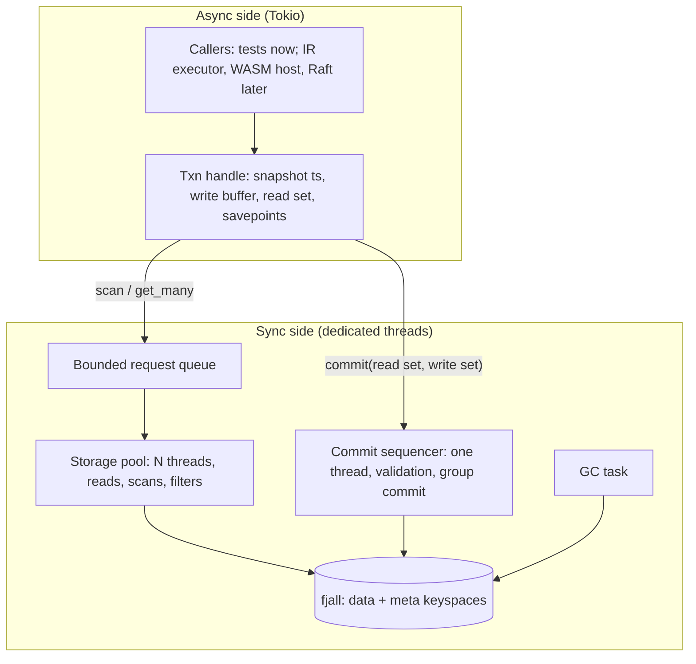

# MVP Design Proposal: fjall Storage Layer

*Draft — 2026-11-16*

## Summary

The MVP is a single-node, embedded, transactional key-value layer on fjall. It offers serializable snapshot isolation with range-conflict tracking, savepoints and a batched async storage interface. It is the foundation the relational IR, Cedar-based security, WASM runtime and Raft replication will sit on.

Storage comes first because every later layer depends on its guarantees, and they are the hardest to change once code is built on them: key encoding, MVCC versioning, isolation semantics and the async/sync boundary. Shipping it alone, with a strong test harness, makes those guarantees concrete before anything depends on them.

The MVP succeeds when:

- Concurrent transactions over the storage interface show no anomalies under SERIALIZABLE, checked by an independent history checker across thousands of randomized runs.
- Committed data survives process kill at any point in the commit path.
- Range scans with pushed-down filters return correct, ordered results at snapshot isolation, in batches, without holding fjall iterators across `.await`.
- A minimal catalog of tables, primary keys and secondary indexes is stored and changed transactionally.

## Goals and non-goals

The MVP builds the transactional core in full and leaves everything above and around it as defined hooks.

| Area | In the MVP | Deferred (hook only) |
| --- | --- | --- |
| Storage engine | fjall, wrapped (option 1), all calls on a dedicated storage pool | Fork with injected scheduler, file system and clock traits (option 2) |
| Transactions | MVCC snapshots, SSI with range tracking, READ COMMITTED, REPEATABLE READ and SERIALIZABLE, savepoints | Pessimistic row locks, serial execution mode |
| Commit path | One commit sequencer, group commit, configurable durability | Raft proposal in place of local commit |
| Interface | Async batched `Storage` trait: begin, scan, get_many, commit | Network endpoints, pgwire |
| Data model | Order-preserving tuple encoding, rows, secondary indexes, minimal catalog | Full Postgres type system, `pg_catalog` |
| Query | Opaque filter and projection hooks in `ScanRequest` | Relational IR, SQL and GraphQL front ends, optimizer |
| Security | Explicit read-set registration for any key a transaction reads (so policy reads join SSI later) | Cedar provider, policy core in the IR |
| Extensibility | None | WASM runtime and host functions |
| Distribution | Single node | Raft per range, timestamp oracle, cross-range commits |

Out of scope for the MVP: performance tuning beyond sane defaults, multi-process access to one database directory, and on-disk format stability across versions.

## Architecture overview

Async code handles waiting; sync code does storage work. The two meet at one batched trait.



- **Txn handle (async side):** holds the snapshot timestamp, the write buffer, the read set and the savepoint stack. Writes never touch storage until commit.
- **Storage pool:** reads and scans run here, including pushed-down filters. Default size is the number of cores (minimum 2), with a bounded queue (default 1,024 requests) that pushes back when full.
- **Commit sequencer:** one dedicated thread that validates, assigns commit timestamps and writes groups of transactions as single fjall batches.
- **GC task:** removes versions no snapshot can see, in chunks, on the storage pool at low priority.

Rule: fjall is never called from an async task, and no fjall iterator outlives one storage-pool call.

## Keyspace layout and key encoding

**Decision: we own MVCC.** We use a plain fjall `Database` (not `OptimisticTxDatabase` or `SingleWriterTxDatabase`) and write versioned keys ourselves through fjall's atomic cross-keyspace write batches. fjall's own sequence numbers are local to one process. Versions that live in our keys stay meaningful when Raft later applies the same log on several replicas, can be read at a chosen timestamp, and let us run SSI with range tracking the way we need it.

### fjall keyspaces

| Keyspace | Holds | Versioned |
| --- | --- | --- |
| `data` | All rows and index entries, including system catalog tables | Yes |
| `meta` | Engine state: format version, last commit timestamp, GC watermark | No |
| `raftlog` (later) | Raft log entries | No |

The catalog lives in `data` under reserved table IDs, so DDL is transactional for free.

### Versioned key layout

```
data key = tuple(table_id, index_id, key columns...) ++ !commit_ts
```

- `commit_ts` is a big-endian `u64` with all bits inverted, so a key's versions sort newest first and sit next to each other.
- The tuple part is self-delimiting (below), so no separator is needed before the version.
- The value is a tagged record: `Put(row bytes)` or `Tombstone`.

A read at snapshot `ts` seeks to `tuple ++ !ts` and takes the first version at or below `ts`. A scan skips older versions of each key as it goes.

### Order-preserving tuple encoding

Each column is a type tag followed by a type-specific body, so the byte order of the encoding equals the logical order of the values.

| Type | Encoding |
| --- | --- |
| NULL | One tag byte: low for NULLS FIRST, high for NULLS LAST (Postgres default: ASC sorts NULLS LAST) |
| bool | `0x00` / `0x01` |
| int16/32/64 | Big-endian, sign bit flipped |
| float64 | Negative: invert all bits; otherwise flip the sign bit. One canonical NaN, sorted above all numbers as in Postgres |
| text, bytea | Raw bytes, `0x00` escaped as `0x00 0xFF`, terminated by `0x00 0x01` |
| DESC column | Every byte of that column's encoding inverted, terminator included |

The MVP supports binary (C) collation only. ICU collations later store a sort key in the index and the original value in the row.

fjall limits keys to 64 KiB, so the row layer caps encoded index keys well below that (default 8 KiB) and rejects longer values with a clear error.

### Row and value format

Row values are not order-preserving: a schema version ID, a null bitmap, then fixed-width columns followed by variable-length columns. The schema version lets later `ALTER TABLE` read old rows without rewriting them.

## Transaction layer

Transactions run optimistically against MVCC snapshots and are validated at commit by one sequencer. Under SERIALIZABLE, that makes the serial order equal the commit order.

### Timestamps

- `commit_ts` is a logical `u64` assigned by the sequencer, increasing by one per committed transaction.
- `visible_ts` is the highest `commit_ts` whose writes are already in fjall. A new snapshot reads at `visible_ts`, so readers never see a timestamp whose data isn't readable yet.
- Later, Raft replaces the sequencer: the log index (or a timestamp derived from it) becomes `commit_ts`, and the rest of the layer stays the same.

### Transaction state

- Snapshot timestamp and isolation level.
- **Write buffer:** an ordered map of key to `Put` or `Delete`. Reads merge it over the snapshot, so a transaction reads its own writes.
- **Read set:** point keys plus key ranges. A scan records the range it actually covered: up to its resume key if it stopped early, not the range it was asked for.
- **Savepoint stack:** positions in the write buffer's undo log.

### Commit validation

The sequencer keeps the write sets of recently committed transactions, ordered by `commit_ts`, and trims them below the oldest active snapshot. A transaction with snapshot `s` aborts if any transaction committed after `s` wrote:

| Isolation level | Conflicts checked |
| --- | --- |
| SERIALIZABLE | A key in its read set or inside a read range, or a key it also writes |
| REPEATABLE READ (snapshot isolation) | A key it also writes (first committer wins) |
| READ COMMITTED | A key it also writes; the snapshot refreshes at each statement boundary (`txn.next_statement()`) |

This backward validation is stricter than full SSI (Cahill et al.). It aborts on any read-write conflict with a later committer, not only on dangerous structures. It's simpler, and it still gives serializability. A side effect is that **read-only transactions skip validation entirely**: a read-only snapshot is a consistent point in the commit order.

Range checks use an ordered set of the committed write keys, queried with a range lookup. That's enough at MVP scale; an interval index can replace it later.

**Known deviation from Postgres:** under READ COMMITTED, Postgres waits on a conflicting writer and re-checks the row (EvalPlanQual). The MVP aborts with SQLSTATE `40001` instead. We'll revisit this when pessimistic locks arrive.

### Savepoints

`ROLLBACK TO` truncates the write buffer back to the savepoint's undo-log position. Reads made after the savepoint stay in the read set. That's conservative, because the transaction may already have acted on what it read.

### Commit pipeline and durability

1. The caller sends its read set, ranges and write set to the sequencer.
2. The sequencer validates the transaction, assigns `commit_ts`, and adds its writes to the current group.
3. The group becomes **one** fjall write batch covering all its transactions, plus the new last-commit timestamp in `meta`.
4. The batch is persisted according to the durability mode. `visible_ts` advances, then every caller in the group gets its acknowledgement.

| Durability mode | Behaviour | Use |
| --- | --- | --- |
| `Sync` | `persist(SyncAll)` once per group before acknowledging | Default |
| `Buffered` | Acknowledge after the write reaches OS buffers | Development and tests |

fjall's own default only flushes to OS buffers, so `Sync` must call `persist(SyncAll)` explicitly. The crash tests verify it.

### Limits

- Maximum write-set size per transaction (default 64 MB).
- Maximum transaction age (default 5 minutes), so a forgotten transaction can't hold back version GC indefinitely.
- Aborts return a typed `SerializationFailure` (`40001`) marked as retryable.

## Storage trait API

The API is coarse-grained and batched: one call per batch of rows, never one per row.

```rust
#[async_trait]
pub trait Storage: Send + Sync + 'static {
    async fn begin(&self, opts: TxnOptions) -> Result<Txn>;
}

pub struct TxnOptions {
    pub isolation: Isolation,   // ReadCommitted | RepeatableRead | Serializable
    pub read_only: bool,
}

impl Txn {
    // Reads: go to the storage pool, merged with the write buffer.
    pub async fn get_many(&mut self, keys: Vec<Key>) -> Result<Vec<Option<Bytes>>>;
    pub async fn scan(&mut self, req: ScanRequest) -> Result<ScanBatch>;

    // Writes: buffered on the async side, no storage call.
    pub fn put(&mut self, key: Key, value: Bytes);
    pub fn delete(&mut self, key: Key);

    // Read-set registration for reads made outside scan/get_many
    // (later: policy data loaded for Cedar).
    pub fn register_read(&mut self, key: Key);
    pub fn register_range(&mut self, range: KeyRange);

    pub fn savepoint(&mut self) -> SavepointId;
    pub fn rollback_to(&mut self, sp: SavepointId) -> Result<()>;
    pub fn next_statement(&mut self);           // READ COMMITTED refresh

    pub async fn commit(self) -> Result<CommitInfo>;  // commit_ts on success
    pub fn abort(self);
}

pub struct ScanRequest {
    pub range: KeyRange,                       // start/end bounds
    pub reverse: bool,
    pub limit_rows: usize,                     // default 1024
    pub limit_bytes: usize,                    // default 1 MiB
    pub resume: Option<Key>,                   // from the previous ScanBatch
    pub filter: Option<Arc<dyn RowFilter>>,    // runs on the storage thread
    pub projection: Option<Projection>,        // columns to keep
}

pub trait RowFilter: Send + Sync {
    fn eval(&self, key: &[u8], value: &[u8]) -> bool;  // must be pure
}

pub struct ScanBatch {
    pub rows: Vec<(Key, Bytes)>,
    pub resume: Option<Key>,                   // None = range exhausted
}
```

Key rules:

- **Resuming needs no held fjall snapshot.** A later call reads at the same `ts`, and newer versions are ignored by timestamp, so each pool call opens and closes its own fjall iterator. Only the GC watermark has to protect versions at or above the oldest active snapshot.
- **Filtering happens after the read is recorded.** Rows a filter rejects were still read, so the scanned range enters the read set regardless of the filter result. Otherwise SSI would miss conflicts.
- **Filters must be pure.** This is the hook where IR predicates and Cedar residuals land later. Only leakproof, side-effect-free code may run here.
- **Write-buffer merge.** Scans merge the transaction's own buffered writes into each batch, so a scan sees the transaction's own inserts and deletes.

## Minimal catalog and row layer

A thin `rows` layer over `Txn` turns tables and indexes into keys. The catalog is three system tables in `data` under reserved table IDs 1–99:

| System table | Columns |
| --- | --- |
| `sys_tables` | table_id, name, schema_version, primary key column list |
| `sys_columns` | table_id, column_id, name, type, nullable |
| `sys_indexes` | index_id, table_id, column list with directions, unique flag |

IDs come from a counter key in `data`, incremented transactionally, so concurrent DDL conflicts and retries like any other transaction.

| Entry | Key | Value |
| --- | --- | --- |
| Row | `tuple(table_id, 0, pk columns)` | Row format above |
| Non-unique index | `tuple(table_id, index_id, index columns, pk columns)` | Empty |
| Unique index | `tuple(table_id, index_id, index columns)` | Primary key |

- **Index maintenance:** `insert`, `update` and `delete` write the row and all its index entries in the same write set, so they commit atomically.
- **Constraints in the MVP:** primary key, unique and NOT NULL. A uniqueness check is a read of the unique index key, so it enters the read set, and two concurrent inserts of the same value conflict at commit under every isolation level (as a write-write conflict on the index key).
- **Deferred:** foreign keys, CHECK constraints, defaults, `ALTER TABLE` beyond adding a nullable column.

## Version garbage collection

Old versions are removed by a background scanner, not by compaction filters.

- **Watermark:** the minimum snapshot timestamp of all active transactions, or `visible_ts` when none are active. It's persisted in `meta` periodically.
- **What's removable:** a version is obsolete when a newer version of the same key exists with `commit_ts` at or below the watermark. A tombstone at or below the watermark with no older versions left is also removable.
- **How:** the GC task scans `data` in chunks on the storage pool at low priority and issues physical deletes in fjall write batches. Physical deletes aren't versioned; they only remove versions no snapshot can see.
- **Why not a compaction filter:** fjall supports custom compaction filters, but a filter sees one SST run at a time, and the newer version of a key may sit in another level. Deciding obsolescence there is error-prone. We may revisit it as an optimization once the GC rules are proven by tests.
- **Pressure valve:** the maximum transaction age caps how far one transaction can hold back the watermark.

## Testing strategy

Correctness is the product, so the test harness gets as much attention as the engine.

| Layer | Technique | Catches |
| --- | --- | --- |
| Tuple encoding | Property tests (`proptest`): encoded byte order equals value order for every type, DESC and NULL placement, composite tuples; round-trip decode | Ordering and escaping bugs |
| Decoder | Fuzzing (`cargo fuzz`) on keys and row values | Panics on corrupt input |
| MVCC and scans | Model-based testing against an in-memory reference store (`BTreeMap` of versions with serial semantics); random operation sequences, results compared | Visibility, resume and merge bugs |
| Isolation | Concurrent randomized workloads (list-append, read-write registers); histories exported to Jepsen's Elle checker | G0, G1a–c, G-single, G2-item, phantoms |
| Durability | Crash harness: kill the process at random points in the commit path, restart, check every acknowledged commit is present and no group is partially applied | Lost or torn commits |
| Upper layers (later) | A deterministic in-memory `Storage` implementation behind the same trait, for `madsim`/`turmoil` simulation | Bugs above storage, replayable from a seed |

The isolation tests also run in negative form: under REPEATABLE READ, the checker should *find* write skew (G2-item). That proves the harness can detect anomalies.

Baseline benchmarks (point reads, scans, commit throughput by group size) run in CI to catch regressions. They are not optimization targets for the MVP.

## Milestones

Roughly 14–15 weeks for one experienced engineer.

| # | Milestone | Duration | Exit criteria |
| --- | --- | --- | --- |
| M1 | Crate skeleton, tuple encoding, keyspaces, `meta` | 2 weeks | Encoding property tests and fuzzing pass |
| M2 | MVCC reads, storage pool, `Storage` trait, scans with resume, write buffer | 3 weeks | Model-based tests pass for single transactions |
| M3 | Sequencer, validation for all three isolation levels, group commit, durability modes, savepoints | 3 weeks | Model-based tests pass with concurrency |
| M4 | Catalog, row layer, secondary and unique indexes | 2 weeks | Transactional DDL; uniqueness holds under concurrent inserts |
| M5 | Version GC, limits, metrics | 2 weeks | Space stays bounded under a sustained update workload |
| M6 | Elle checking, crash harness, hardening | 2–3 weeks | Thousands of randomized runs with no anomalies or lost commits |

## Risks and open questions

### Risks

- **Sequencer throughput.** One validating thread is fine at the target scale but caps commit rate. Measure in M3 before worrying.
- **Abort rate.** Backward validation aborts more than Postgres's SSI. If it hurts, upgrade to full SSI (tracking incoming and outgoing read-write dependencies) without changing the API.
- **Write amplification.** Our MVCC versions sit on top of fjall's own LSM versioning. That's acceptable for small workloads; GC keeps it bounded.
- **Memory.** Write buffers and read sets live in memory. The write-set cap bounds the first. Large `get_many` read sets may need coalescing into ranges.
- **READ COMMITTED deviation.** Aborting instead of re-checking may surprise Postgres users until pessimistic locks exist.
- **fjall durability.** Correctness depends on calling `persist(SyncAll)` and on fjall's own fsync discipline for new files. The crash harness is the check.

### Open questions

- **`commit_ts` format.** A plain `u64` suits a timestamp oracle. If hybrid logical clocks are ever chosen, pack physical and logical parts into the same 64 bits now, so the key format doesn't change.
- **Statement boundaries.** Should READ COMMITTED refresh at `next_statement()` only, or also per scan call?
- **Pool sizing.** One shared pool, or separate pools for reads and GC?

### Hooks for later layers

| Later layer | Hook in the MVP |
| --- | --- |
| Raft | The sequencer becomes the leader's proposal path; an apply thread writes the same fjall batches; `commit_ts` derives from the log |
| Relational IR | `ScanRequest` (range, filter, projection, limit) is the target of the leaf scan operator |
| Cedar security | `register_read` / `register_range` put policy data into the read set; residual predicates arrive as `RowFilter`s |
| WASM | Host functions map onto `Txn` methods; the async trait lets wasmtime suspend guests during storage calls |
| Option 2 fork | Everything that touches fjall is already behind the storage pool and sequencer, so scheduler, file system and clock traits slot in underneath |
